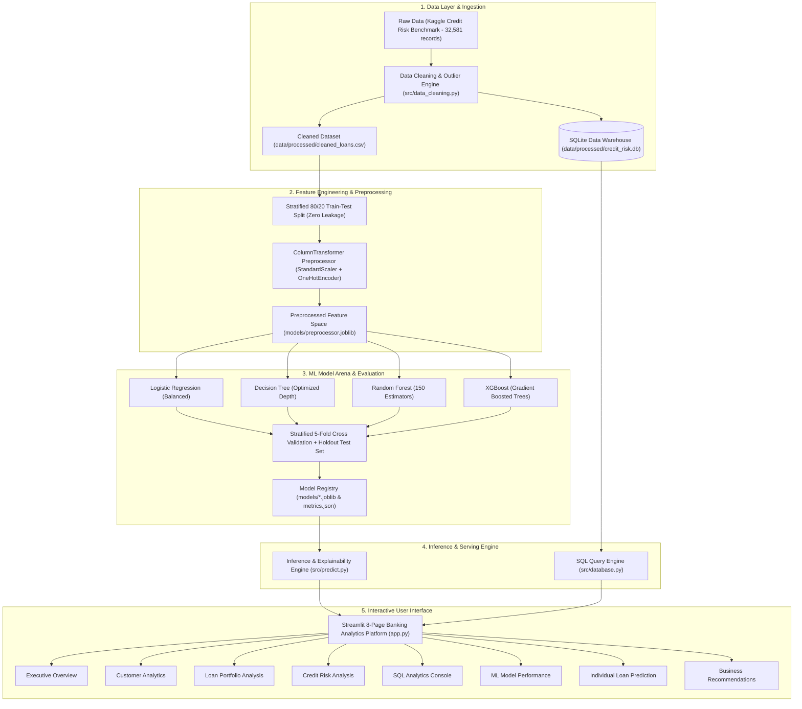
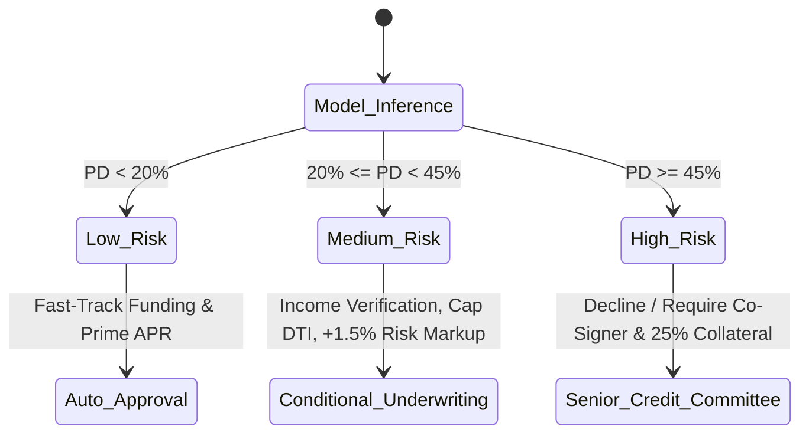

# System Architecture & Technical Specifications

**Credit Risk Analysis and Loan Default Prediction System**  
*Enterprise Banking Intelligence Platform & Decisioning Engine*

---

## 1. High-Level System Architecture



---

## 2. Component Design & Pipeline Flow

### 2.1 Data Cleaning & Integrity Safeguards (`src/data_cleaning.py`)
- **Deduplication:** Identified and eliminated 165 exact duplicate records.
- **Biophysical & Entry Outlier Filtering:**
  - `person_age`: Restrained to realistic borrower window $[18, 90]$. Eliminated data-entry errors (e.g., ages 123 and 144).
  - `person_emp_length`: Enforced domain boundary condition $\text{emp\_length} \le (\text{age} - 14)$ and $\text{emp\_length} \le 50$.
- **Leakage-Free Imputation Strategy:**
  - `loan_int_rate`: Missing values imputed using the median rate of each corresponding `loan_grade` (reflecting true institutional underwriting mechanics where loan grade dictates base interest rates).
  - `person_emp_length`: Missing tenure imputed via age-cohort medians.
- **Data Warehouse Persistence:** Cleaned records loaded into SQLite (`credit_risk.db`) with B-tree indices on `loan_id`, `loan_grade`, `loan_intent`, `income_group`, and `application_month`.

---

## 3. Machine Learning Methodology

### 3.1 Data Leakage Prevention
To prevent data contamination:
1. The 80/20 train-test partition is stratified on the target label (`loan_status`).
2. Imputation parameters, standard scalers, and categorical encoders are fitted **strictly** on the training fold.
3. The 20% test fold (6,482 loans) is held out untouched until final model verification.

### 3.2 Imbalance & Algorithm Strategy
The dataset exhibits a natural loan default rate of 21.87% (78.13% non-default).
- **Logistic Regression:** Regularized with `class_weight='balanced'`.
- **Decision Tree:** Constrained depth to avert overfitting, with balanced class weights.
- **Random Forest:** 150 bagged ensembles, evaluating bootstrap sampling across subprime cohorts.
- **XGBoost:** Gradient boosted decision trees using `scale_pos_weight=1.5`, `learning_rate=0.08`, `subsample=0.85`, and `colsample_bytree=0.85`.

### 3.3 Model Performance Matrix (Unseen Holdout Test Set)

| Model | Accuracy | Precision | Recall | F1-Score | Holdout ROC-AUC | 5-Fold CV ROC-AUC |
| :--- | :---: | :---: | :---: | :---: | :---: | :---: |
| **XGBoost** (Champion) | **93.52%** | **94.08%** | **75.11%** | **0.8353** | **0.9457** | **0.9406 (±0.005)** |
| **Random Forest** | 93.21% | 95.87% | 72.07% | 0.8229 | 0.9275 | 0.9251 (±0.005) |
| **Decision Tree** | 88.94% | 74.09% | 76.02% | 0.7504 | 0.9024 | 0.8980 (±0.006) |
| **Logistic Regression** | 80.65% | 54.00% | 78.07% | 0.6384 | 0.8715 | 0.8705 (±0.006) |

---

## 4. Underwriting & Risk Decision Logic (`src/predict.py`)

$$\text{PD} = P(\text{loan\_status} = 1 \mid \mathbf{x})$$

The inference engine categorizes the borrower into three policy tiers:



---

## 5. Directory & File Structure

```
Credit_Risk_Analysis/
├── data/
│   ├── raw/
│   │   └── credit_risk_dataset.csv     <- Real benchmark credit dataset (32,581 records)
│   └── processed/
│       ├── cleaned_loans.csv           <- Cleaned & feature-engineered dataset (32,408 records)
│       └── credit_risk.db              <- SQLite Data Warehouse with analytical indices
├── src/
│   ├── __init__.py
│   ├── data_cleaning.py                <- Deduplication, imputation, outlier detection
│   ├── database.py                     <- SQLite connection manager & query suite
│   ├── train_models.py                 <- 4-model trainer, CV, ROC/PR curves & serializer
│   └── predict.py                      <- Real-time underwriting inference engine
├── models/
│   ├── preprocessor.joblib             <- ColumnTransformer fitted on train fold
│   ├── xgboost.joblib                  <- Serialized champion XGBoost model
│   ├── random_forest.joblib            <- Serialized Random Forest model
│   ├── decision_tree.joblib            <- Serialized Decision Tree model
│   ├── logistic_regression.joblib      <- Serialized Logistic Regression model
│   ├── model_metrics.json              <- Full test evaluation & curve coordinates
│   ├── feature_importance.json         <- Top global predictive feature rankings
│   └── feature_metadata.json           <- Categorical encoders & numerical schemas
├── sql/
│   ├── schema.sql                      <- Complete DDL schema with primary keys & indices
│   └── queries.sql                     <- Production SQL analytics suite
├── tests/
│   └── test_pipeline.py                <- Pytest automated test suite (100% pass)
├── app.py                              <- 8-Page enterprise Streamlit dashboard
├── requirements.txt                    <- Locked production dependencies
├── ARCHITECTURE.md                     <- Engineering & system architecture specifications
└── README.md                           <- Quickstart & comprehensive documentation
```
